# dotfiles

A cyberpunk-themed **Arch Linux + Hyprland** desktop, managed with [chezmoi](https://www.chezmoi.io/).
Every app takes its colors from one palette file, so the whole desktop is recolored by editing one file and running one build script.

## Contents

- [Screenshots](#screenshots)
- [Wallpapers](#wallpapers)
- [Install](#install)
- [Keybinds](#keybinds)
- [Streaming to a TV or phone](#streaming-to-a-tv-or-phone)
- [Tools and what they do](#tools-and-what-they-do)
- [Notes from building it](#notes-from-building-it)
- [Theme system](#theme-system)
- [Wofi menus](#wofi-menus)

---

## Screenshots

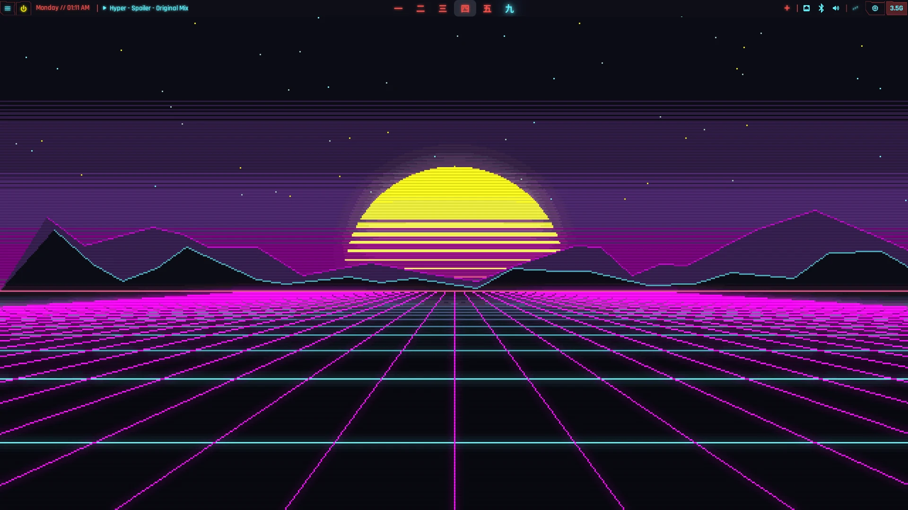

**waybar** · `SUPER + W` to toggle: control menu, power, clock, media, kanji workspaces, tray drawer, status icons

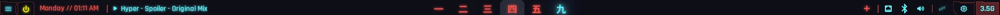

| Lock screen (hyprlock) · `SUPER + ALT + L` | Login screen (SDDM) · at boot |
|---|---|
| 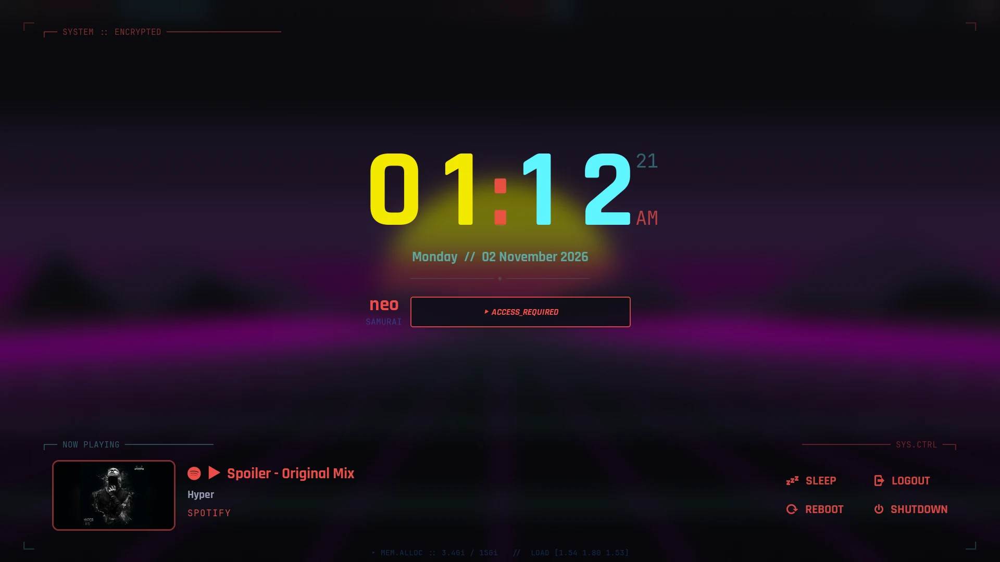 | 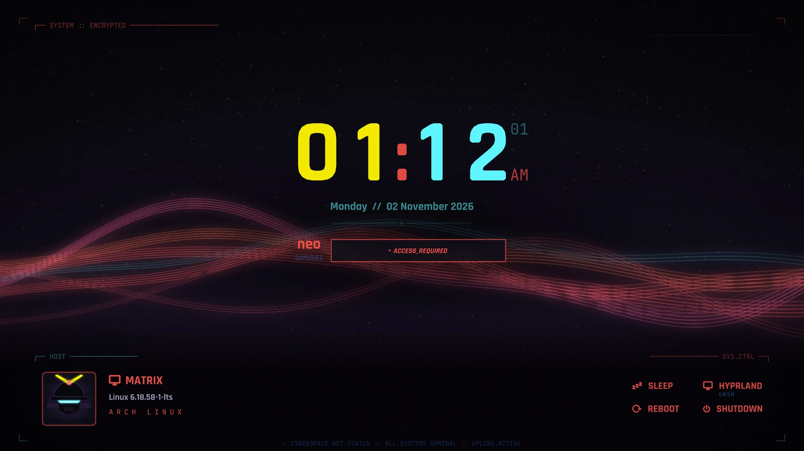 |
| Also the real login: SDDM autologins, then hyprlock starts first | Same layout as the lock screen |

**wofi menus**

| Control menu · `SUPER + X` | Launcher · `SUPER + Space` | Power menu · `SUPER + ALT + P` |
|---|---|---|
| 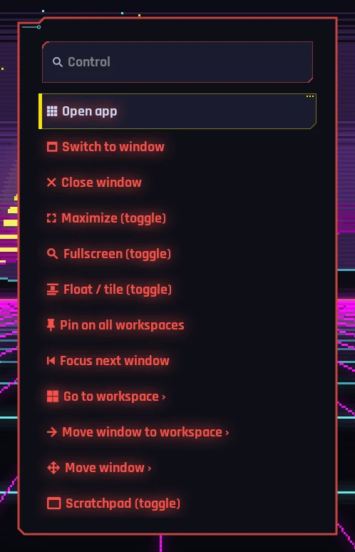 | 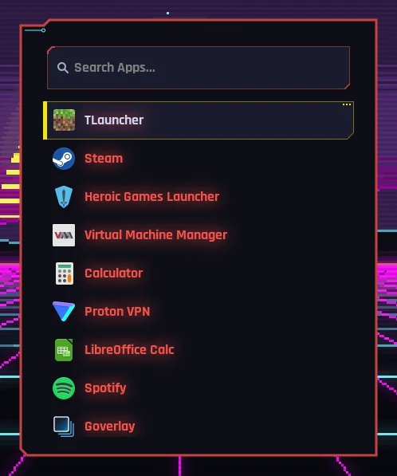 | 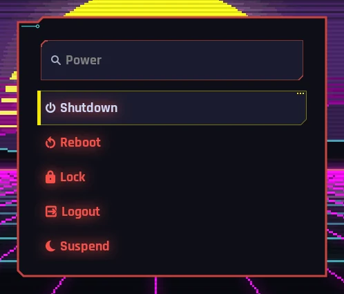 |

**Notifications and OSD**

| Control center (swaync) · `SUPER + N` | Notifications | Volume OSD (swayosd) · volume keys |
|---|---|---|
| 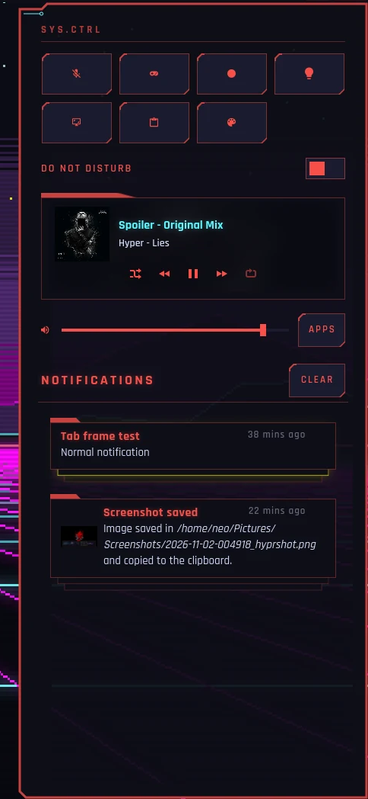 | 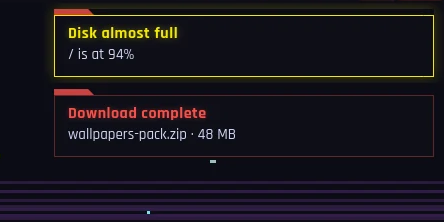 | 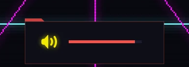 |

**Wallpaper picker** · `SUPER + SHIFT + W`: a filmstrip of thumbnails cropped to the screen's shape

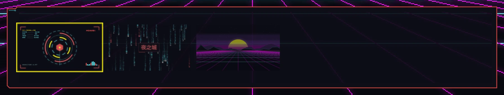

**Terminal** · `SUPER + Return`: ghostty + fastfetch + starship

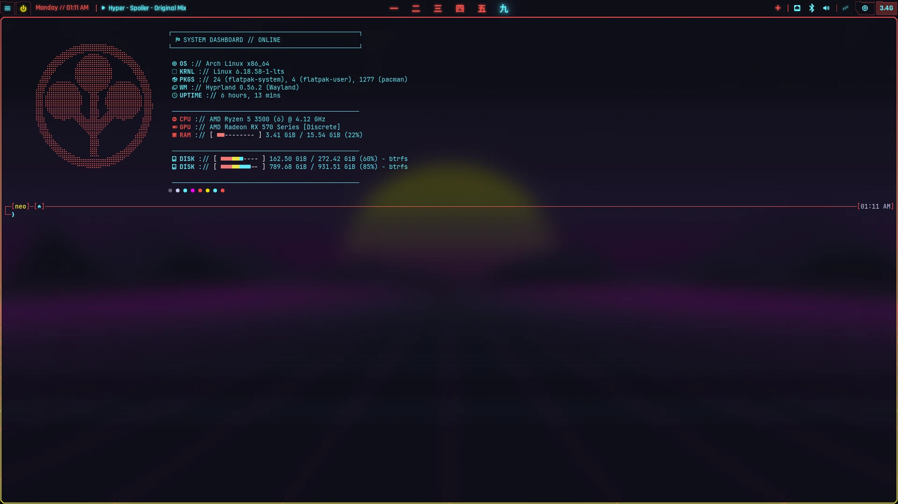

---

## Wallpapers

Animated pixel-art loops in the theme palette (640×360 scaled 3× to 1920×1080, seamless 72-frame loops):

| | | |
|---|---|---|
| 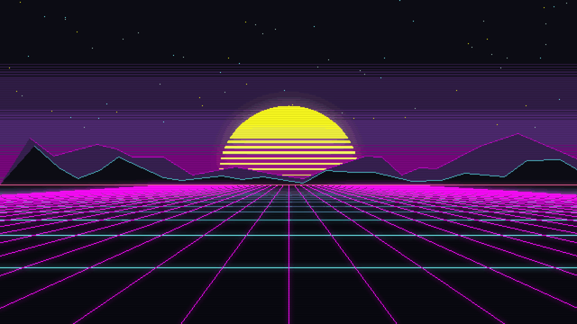 | 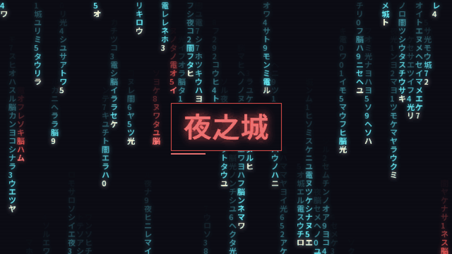 | 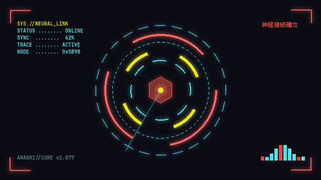 |
| `gen-synthwave-horizon.gif` | `gen-kanji-rain.gif` | `gen-hud-core.gif` |

---

## Install

```sh
chezmoi init --apply materialSlime/dotfiles
~/.config/theme/install-fonts.sh # fonts: asks "just me" or "all users"
~/.config/theme/build            # generate colors for every app
~/.config/theme/build --sddm     # optional: login screen theme (sudo)
```

`install-fonts.sh` downloads **Rajdhani** and **Noto Sans JP** from Google Fonts and
**JetBrains Mono Nerd Font** from Nerd Fonts (all SIL Open Font License). Use
`--user` for `~/.local/share/fonts` or `--system` for `/usr/local/share/fonts`
(pick system if you use the SDDM theme, so the login screen can see them).

Main packages: `hyprland uwsm hyprlock hypridle awww waybar (or waybar-git) wofi swaync swayosd ghostty tmux starship fastfetch cliphist hyprshot python-pillow`.

> `chezmoi apply` overwrites live files with the repo version. Run `chezmoi diff` first to see what would change.

---

## Keybinds

`SUPER` is the main modifier.

| Keys | Action |
|---|---|
| `SUPER + Return` | Terminal |
| `SUPER + Space` / `SUPER + R` | App launcher / run command |
| `SUPER + X` | Control menu |
| `SUPER + ALT + P` / power key | Power menu |
| `SUPER + Q` | Close window |
| `SUPER + E` | File manager (nemo) |
| `SUPER + H/J/K/L` | Move focus |
| `SUPER + 1…0` / `SUPER + SHIFT + 1…0` | Go to / move window to workspace |
| `SUPER + V` / `SUPER + SHIFT + V` | Clipboard history / delete entries |
| `SUPER + N` | Notification center |
| `SUPER + W` | Toggle waybar |
| `SUPER + SHIFT + W` | Wallpaper picker |
| `SUPER + ALT + W` | Next wallpaper |
| `SUPER + C` | Caffeine (block idle/sleep) |
| `SUPER + ALT + L` | Lock screen |
| `SUPER + CTRL + B` / `SUPER + CTRL + A` | Bluetooth TUI / audio mixer TUI |

The full list is in `.config/hypr/bindings.lua`.

---

## Streaming to a TV or phone

I use this desktop a lot from the couch: Sunshine on the PC, Moonlight on the TV or
a phone. A tiling window manager assumes a keyboard with a SUPER key, so a few
things are set up to make it usable without one.

**Sunshine**
- **No monitor needed.** If no physical monitor is plugged in, autostart creates a
  headless `SUNSHINE` output (1280×720@60) before Sunshine starts, because Sunshine
  only looks for outputs once, at startup. Sunshine rescales to whatever the client
  asks for. No HDR: the RX 570 can't encode 10-bit.
- **Survives suspend.** Sunshine crashes if a stream is open across suspend and
  resume, so it runs in a loop that restarts it.
- **No sleeping mid-stream.** When a stream starts, Sunshine creates
  `/tmp/sunshine-stream.lock`, and hypridle skips suspend while it exists.
- **The bar comes back.** Starting a stream also makes sure waybar is running, since
  a phone keyboard has no SUPER+W to bring it back.

**Touch and mouse**
- The **control menu** (the 󰍜 button on waybar) has every everyday keybind action:
  close, fullscreen, float, move to workspace, switch window, power. Tap a window,
  then tap the action.
- Right-click (long-press on a phone) or Esc goes back one level. Tapping 󰍜 again
  closes everything.

**Gamepad**

`wofi/gamepad/gamepad-menu.py` turns a controller into a remote for the tiling
desktop, even while a game is running:

| Button | Action |
|---|---|
| Back + Start | Open / close the control menu, from anywhere |
| D-pad / left stick | Move through the menu (hold to repeat) |
| A | Select |
| B | Back / close |
| LB / RB | Previous / next workspace |

**RustDesk** is set up for unattended access too: a custom screen-share picker
selects the focused monitor by itself, so no dialog waits for a click nobody can
make.

---

## Tools and what they do

### Desktop core

| Tool | Use | Config |
|---|---|---|
| **Hyprland** | Tiling Wayland compositor, configured in Lua and started through uwsm | `.config/hypr/` |
| **hyprlock** | Lock screen and the real login: big clock and password in the center, now playing (with cover art) bottom left, power grid bottom right | `.config/hypr/hyprlock.conf` |
| **hypridle** | Idle handling: screensaver after 150 s, lock after 152 s, suspend after 700 s. All skipped while "caffeine" is on | `.config/hypr/hypridle.conf` |
| **Screensaver** | Terminal text-effects animation (`tte`) of the logo; exits on any input | `.config/screensaver/` |
| **awww** | Animated wallpaper daemon (GIF support, fade transitions) | `.config/wofi/wallpaper/wallpaper.sh` |
| **SDDM theme** | Login screen that mirrors the hyprlock layout | `.config/theme/sddm/` |

### Bar, menus and notifications

| Tool | Use | Config |
|---|---|---|
| **waybar** | Top bar: control menu, power, clock / year-progress toggle, media, kanji workspaces (一–十), tray drawer, bluetooth, network, audio, caffeine, CPU, memory, battery | `.config/waybar/` |
| **wofi** | Every menu: app launcher, control menu, power menu, clipboard history and wallpaper picker. See [Wofi menus](#wofi-menus) | `.config/wofi/` |
| **swaync** | Notification center with quick toggles (mic mute, game mode, screen record, region screenshot, clipboard, GTK theme), DND, media and volume | `.config/swaync/` |
| **swayosd** | On-screen display for volume and brightness | `.config/swayosd/` |

### Terminal

| Tool | Use | Config |
|---|---|---|
| **ghostty** | Terminal: JetBrainsMono Nerd Font + Noto Sans JP, translucent with blur | `.config/ghostty/` |
| **tmux** | Multiplexer; prefix `Ctrl+Space` (`Ctrl+b` still works), status bar on top | `.config/tmux/` |
| **starship** | Two-line `┌─ / └─` prompt in the theme palette | `.config/starship.toml` |
| **fastfetch** | "System dashboard" style system info with a custom logo | `.config/fastfetch/` |
| **Neovim** | LazyVim-based editor config | `.config/nvim/` |

### Look and feel

| Tool | Use | Config |
|---|---|---|
| **theme/build** | Generates every app's colors from one palette. See [Theme system](#theme-system) | `.config/theme/` |
| **GTK 3 / 4** | GTK apps follow the palette (adw-gtk3 named colors) | `.config/gtk-3.0/`, `.config/gtk-4.0/` |

---

## Notes from building it

**Hyprland turned out to be the easy part.** My whole compositor config is a few
small Lua files (`input`, `autostart`, `monitors`, `animations`, `looknfeel`,
`bindings`, `windowrules`) that `hyprland.lua` pulls in. Everything else is just a
program or a script that Hyprland starts. There's no big framework to fight, so
when something breaks I usually know which file to open.

**waybar needed a lot of custom work.** I wanted the clock to flip to a year
progress bar. I wanted a progress bar on the media widget. The network widget broke
whenever the Wi-Fi interface name changed. Each of those became a script, so now
most of the bar is custom: seven `custom/*` modules running `clock-manager.sh`,
`mediaplayer.sh`, `network-status.sh` and `caffeine.sh`, plus a little drawer that
hides the tray.

**wofi is easy to extend.** All it does is show a list and hand back whatever you
picked. That turned out to be enough for the app launcher, the control menu, the
power menu, the clipboard picker and a wallpaper filmstrip with thumbnails. A small
script even lets a gamepad drive it. Every menu runs as its own wofi with its own
stylesheet, so tweaking one never breaks another.

**hyprlock alignment was the hardest part.** It has no layout system. Every label,
image and box is placed on its own with an anchor and a pixel offset, and it can't
measure text. So every part of the screen (the media block, the power grid, the
headers, the username sitting next to the password box) got lined up by hand. That's
around a hundred position and align lines. The clock was the worst of it. Rajdhani's
digits aren't all the same width, so a centered clock shuffled sideways every
minute. The fix in `hypr/Scripts/clock.sh`: an invisible `88:88` that holds the
width, plus a separate label for every digit slot. 17 of the 35 labels on that
screen are just the clock. And every single tweak meant lock, look, type my
password, unlock, edit, try again. AI help made that loop a lot shorter.

Then the login screen had to match it. SDDM themes are written in QML, which I
don't know, so I had AI port the layout over (`theme/sddm/Main.qml`).

**The SVG frames were the fun part.** The panel frames, notification cards and
buttons are custom 9-slice SVGs: cut corners, a stepped top edge, little angled
tabs, a circuit trace here and there. GTK stretches them as `border-image`.
They're drawn in fixed colors, and `theme/build` repaints them from the palette,
so when I change a color the frames follow.

**Shell for most things, Python when shell isn't a good fit.** Most of the glue is
shell, about two dozen scripts. I reached for Python when a job was a bad fit for
it:
- The gamepad menu (`wofi/gamepad/gamepad-menu.py`) reads raw `/dev/input` events
  and fakes key presses through `uinput`. Binary data like that is hard to handle
  in bash, and Python does it with just the standard library.
- Wallpaper thumbnails and album covers (`wallpaper-thumbs.py`, `cover-frame.py`)
  are image work: crop to the screen's shape, grab a GIF frame a quarter of the way
  in (lots of loops fade in from black), blur a backdrop behind the cover.
- `theme/build` mixes colors, writes a color file for every app, repaints the SVGs
  and reloads everything. Far too much logic for a shell script.

It went the other way once, too. The media module started life as
`mediaplayer.py` and ended up as plain bash.

**About AI.** I wasn't sure about it at first, but I came around. I used an AI
assistant to learn and set up a lot of this: GTK CSS quirks, the hyprlock layout,
the QML port, the theme build script. It cuts the trial and error way down. What
the desktop looks like is still my call. Full disclosure: AI also wrote this
README, from my notes and the actual config files.

---

## Theme system

All colors live in **`.config/theme/palette`**:

```ini
bg        = #0E0E17   # background everywhere
primary   = #F75049   # borders, alerts
secondary = #5EF6FF   # text accent, highlights
accent    = #F3E900   # selection, focus
```

Running **`~/.config/theme/build`** generates `~/.config/theme/gen/` and reloads the apps. The basic color files in `gen/` are tracked, so a fresh install has colors before the first build. The recolored SVGs are not tracked.

| Generated file | Used by |
|---|---|
| `colors.css` | waybar, wofi, swaync, swayosd |
| `colors.lua` | Hyprland borders (`require("colors")`) |
| `colors.conf` | hyprlock |
| `ghostty` | terminal |
| `gtk3.css`, `gtk4.css` | GTK apps |
| `zen.css` | Zen browser UI |
| `sddm.conf` | login screen (`build --sddm`, needs sudo) |
| `wofi/*.svg`, `waybar/**/*.svg`, `swaync/*.svg` | recolored copies of the frame/panel SVGs |
| starship palette | patched into `starship.toml` between markers |

To change the look, edit `palette` and run `build`. Don't edit files in `gen/`; they're overwritten on every build.

---

## Wofi menus

wofi runs as a separate process for each menu, and each launcher passes its own `--style`. Files are grouped by menu:

```
.config/wofi/
├── config                 shared defaults, read by every wofi launch
├── shared/
│   ├── assets/            9-slice frame SVGs (stepped-lip menu frame, input, selected), recolored by theme/build
│   └── menu.css           style for the control, power and clipboard menus
├── launcher/style.css     SUPER+Space / SUPER+R
├── control-menu/          control-menu.sh (SUPER+X, waybar 󰍜) and power-menu.sh
├── clipboard/             clipboard.sh: cliphist picker
├── gamepad/               gamepad-menu.py
└── wallpaper/             wallpaper.sh, wallpaper-picker.sh, wallpaper-thumbs.py, style.css
```

- **Control menu**: every common window/workspace action, usable by mouse or touch (made for Moonlight on a phone). Right-click goes back or closes.
- **Wallpaper picker**: a single row of thumbnails at the bottom of the screen. Thumbnails are cropped to the monitor's aspect ratio, `h`/`l` or arrows to browse, Enter to apply.
- **`wallpaper.sh`**: sets wallpapers through awww with a fade transition, remembers the choice in `~/.local/state/wallpaper/current` and restores it at login. `wallpaper.sh next` goes to the next one.
